# ERD (MVP)

The diagram is written in Mermaid so it renders on GitHub and in VS Code (Markdown preview with Mermaid support). The explanation, the decisions, and the invariants are in [data-model.md](data-model.md).

## How to read it

- Every box whose name has no `_` prefix is a **MongoDB collection**.
- Boxes named `PARENT__CHILD` (double underscore) are **embedded sub-documents** stored inside the parent document, not collections. The relationship label says `embeds`.
- `PK` = `_id`, `FK` = stores another document's `_id` (a reference), `UK` = unique index.
- Money is `int` in piasters (EGP x 100). Dates are UTC.
- Fields marked `snapshot` in the comment are copied at checkout and never follow later changes.
- `createdAt` / `updatedAt` (Mongoose `timestamps`) exist on every collection and are not repeated in the boxes.

## Diagram

```mermaid
erDiagram
    USER ||--o{ USER__ADDRESS : "embeds (max 10)"
    USER ||--o| CART : "owns (0 or 1)"
    USER ||--o{ ORDER : places
    USER ||--o{ RETURN_REQUEST : opens
    USER ||--o{ AUDIT_LOG : "acts in"

    CATEGORY ||--o{ PRODUCT : classifies
    PRODUCT ||--|{ VARIANT : "has (1 or more)"

    CART ||--o{ CART__ITEM : "embeds (max lines from config)"
    VARIANT ||--o{ CART__ITEM : "referenced by"

    ORDER ||--|{ ORDER__ITEM : "embeds (snapshots)"
    ORDER ||--|| ORDER__SHIPPING_ADDRESS : "embeds (snapshot)"
    ORDER ||--o| ORDER__COUPON : "embeds (snapshot)"
    ORDER ||--|{ ORDER__STATUS_HISTORY : "embeds (append-only)"
    VARIANT ||--o{ ORDER__ITEM : "referenced by"
    COUPON ||--o{ ORDER__COUPON : "referenced by"
    SHIPPING_ZONE ||--o{ ORDER : "fee snapshot taken from"

    ORDER ||--o{ RETURN_REQUEST : "returned through"

    USER {
        ObjectId _id PK
        string name
        string email UK "lowercase, trimmed"
        string phone "Egyptian mobile format"
        string passwordHash "select: false"
        string role "enum: admin, catalog_manager, order_operator, customer; default customer"
        bool isActive "default true"
        date passwordChangedAt "tokens issued before this are rejected"
        string passwordResetTokenHash "select: false, optional"
        date passwordResetExpiresAt "select: false, optional"
        USER__ADDRESS[] addresses "embedded, max 10"
    }

    USER__ADDRESS {
        ObjectId _id "used as addressId in POST /orders"
        string label "Home, Work"
        string recipientName
        string phone
        string governorate "from shared governorate constant"
        string city
        string street
        string building
        string apartment "optional (floor / apartment)"
        string notes "optional"
        bool isDefault "at most one true"
    }

    CATEGORY {
        ObjectId _id PK
        string name UK "case-insensitive"
        string slug UK "server-generated"
        string description "optional"
        bool isActive
    }

    PRODUCT {
        ObjectId _id PK
        string title
        string slug UK "server-generated"
        string description
        ObjectId categoryId FK "-> CATEGORY"
        string[] images "URL strings, max 10"
        object[] attributes "optional name/value pairs for display"
        bool isActive
    }

    VARIANT {
        ObjectId _id PK
        ObjectId productId FK "-> PRODUCT"
        string sku UK "uppercase, unique across all products, immutable"
        string size "optional"
        string color "optional"
        int price "piasters, > 0"
        int stock "integer, >= 0, starts at 0"
        bool initialStockSet "default false, flipped by first initial_stock adjustment"
        bool isActive
    }

    SHIPPING_ZONE {
        ObjectId _id PK
        string name UK
        string[] governorates "non-empty, each in at most one active zone"
        int fee "piasters, >= 0"
        bool isActive
    }

    CART {
        ObjectId _id PK
        ObjectId userId FK "UK, one cart per customer"
        CART__ITEM[] items "embedded"
    }

    CART__ITEM {
        ObjectId variantId FK "-> VARIANT"
        int quantity "1 .. max per line"
        date addedAt
    }

    COUPON {
        ObjectId _id PK
        string code UK "uppercase, trimmed"
        string type "enum: percent, fixed"
        int value "percent 1..100, or piasters"
        int maxDiscount "piasters, percent only, optional"
        int minSubtotal "piasters, default 0"
        date startsAt
        date expiresAt
        int usageLimit "optional, null = unlimited"
        int usedCount "server-managed, default 0"
        bool isActive
    }

    ORDER {
        ObjectId _id PK
        string orderNumber UK "human-readable, separate from _id"
        ObjectId userId FK "-> USER"
        ORDER__ITEM[] items "embedded snapshots"
        ORDER__SHIPPING_ADDRESS shippingAddress "embedded snapshot"
        ORDER__COUPON coupon "embedded snapshot, optional"
        int subtotal "piasters"
        int discount "piasters, <= subtotal"
        string shippingZoneName "snapshot"
        int shippingFee "piasters, snapshot"
        int total "piasters, >= 0"
        string currency "EGP"
        string status "pending, accepted, packing, shipped, delivered, cancelled"
        string paymentMethod "cod"
        string paymentStatus "values from P1-T09, starts pending"
        date paidAt "optional"
        ObjectId paidById FK "-> USER (staff), optional"
        string carrier "optional, set on shipped"
        string trackingNote "optional"
        date shippedAt "optional"
        date deliveredAt "optional"
        date cancelledAt "optional"
        ObjectId cancelledById FK "-> USER, optional"
        string cancelledByRole "customer or staff role, optional"
        string cancellationReason "optional"
        ORDER__STATUS_HISTORY[] statusHistory "embedded, append-only"
    }

    ORDER__ITEM {
        ObjectId productId FK "-> PRODUCT (for links only)"
        ObjectId variantId FK "-> VARIANT (for stock restore)"
        string sku "snapshot"
        string title "snapshot"
        string size "snapshot"
        string color "snapshot"
        int unitPrice "snapshot, piasters"
        int quantity
        int lineTotal "unitPrice x quantity"
    }

    ORDER__SHIPPING_ADDRESS {
        string recipientName "snapshot"
        string phone "snapshot"
        string governorate "snapshot"
        string city "snapshot"
        string street "snapshot"
        string building "snapshot"
        string apartment "snapshot"
        string notes "snapshot"
    }

    ORDER__COUPON {
        ObjectId couponId FK "-> COUPON (to release usage on cancel)"
        string code "snapshot"
        string type "snapshot"
        int value "snapshot"
        int maxDiscount "snapshot"
    }

    ORDER__STATUS_HISTORY {
        string status
        date at
        ObjectId byId FK "-> USER"
        string byRole
        string note "optional"
    }

    RETURN_REQUEST {
        ObjectId _id PK
        ObjectId orderId FK "-> ORDER"
        ObjectId userId FK "-> USER"
        object[] items "variantId, sku, quantity (subset of order items)"
        string reason
        string status "requested, approved, rejected, received"
        string refundStatus "not_required, pending, refunded_manually"
        object[] history "status, at, byId"
    }

    AUDIT_LOG {
        ObjectId _id PK
        ObjectId actorId FK "-> USER"
        string actorRole "role at the time of the action"
        string action "fixed set, e.g. inventory.adjusted, variant.price_changed"
        string entityType "variant, order, coupon, user, shipping_zone, ..."
        ObjectId entityId
        object changes "before / after of changed fields"
        string reason "optional; required for inventory.adjusted"
        object metadata "optional extra data, e.g. stock change and note"
        date createdAt "append-only, never updated"
    }
```

## Indexes (summary)

| Collection | Index | Why |
|---|---|---|
| users | `{ email: 1 }` unique | login lookup, no duplicate accounts |
| users | `{ role: 1, isActive: 1 }` | staff list, "at least one active admin" count |
| categories | `{ slug: 1 }` unique; `{ name: 1 }` unique, case-insensitive | URL lookup, no duplicate names |
| products | `{ slug: 1 }` unique | detail by slug |
| products | `{ categoryId: 1, isActive: 1 }` | listing by category; block hard-delete of a used category |
| products | search index on `title` / `description` | chosen in P3-T07 (text index or regex) |
| variants | `{ sku: 1 }` unique | SKU unique across **all** products |
| variants | `{ productId: 1, size: 1, color: 1 }` unique | no two variants of one product with the same size+color |
| variants | `{ productId: 1, isActive: 1 }` | load a product's variants for listing and detail |
| shippingzones | `{ name: 1 }` unique | no duplicate zone names |
| shippingzones | `{ governorates: 1 }` unique, partial on `isActive: true` | a governorate belongs to at most one active zone, even under concurrent requests |
| carts | `{ userId: 1 }` unique | one cart per customer |
| coupons | `{ code: 1 }` unique | lookup by code |
| orders | `{ orderNumber: 1 }` unique | human-readable reference |
| orders | `{ userId: 1, createdAt: -1 }` | customer order history |
| orders | `{ status: 1, createdAt: -1 }` | staff order queue |
| returnrequests | `{ orderId: 1, status: 1 }` | "one open request per order" check |
| auditlogs | `{ entityType: 1, entityId: 1, createdAt: -1 }` | history of one entity |
| auditlogs | `{ actorId: 1, createdAt: -1 }`; `{ action: 1, createdAt: -1 }` | who did what; filter by action |
