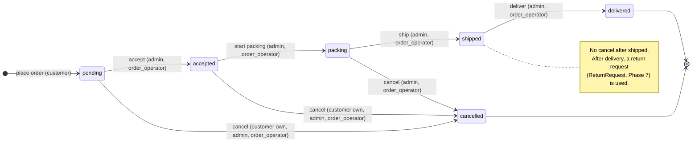
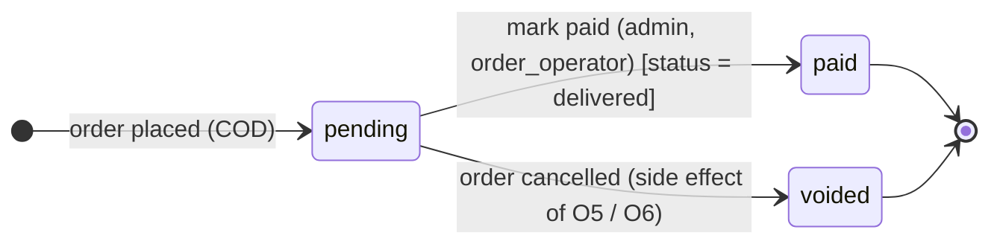

# Order and payment state machines (P1-T09)

This file is the single source of truth for how an order's `status` and `paymentStatus` may change. P5-T01, P5-T05, P6-T02, P6-T03 and P6-T04 each implement a part of it; re-read it before each of them.

Diagrams are Mermaid `stateDiagram-v2` (Mermaid docs, "State diagrams", `docs/syntax/stateDiagram.md`, checked through Context7 on 2026-11-27). Field names match [data-model.md](data-model.md), section 2.9.

## 1. Rules that shape everything

1. **Whitelist.** The tables below list every allowed move. Anything not listed is forbidden and returns `409`. There is no list of forbidden moves, because such a list always misses a case (going back, skipping a step, leaving a final state, moving to the same state).
2. **The server owns the state.** The client never sends "set status to X". It asks for an **action** ("ship this order"), and the server checks the current state against the table.
3. **Two machines, not one field.** `status` is logistics, `paymentStatus` is money. They are linked by **guards** ("mark paid only when delivered") and by one shared side effect (cancel voids the payment), not merged into one field. A future online payment gateway changes only the payment machine.
4. **Final states never change.** `delivered` and `cancelled` are final for `status`; `paid` and `voided` are final for `paymentStatus`.

## 2. Order status machine (`status`)

### 2.1 Transition table (the whitelist)

| # | Action | From | To | Who may trigger | Guard (must be true) | Side effects (same write or same transaction) |
|---|---|---|---|---|---|---|
| O0 | place order | (none) | `pending` | customer | cart valid, stock and coupon checks pass (P5-T01/T02) | order created with `paymentStatus: pending`; first `statusHistory` entry; stock deducted; coupon `usedCount` +1; cart cleared; audit `stock.deducted_by_order` per line |
| O1 | accept | `pending` | `accepted` | admin, order_operator | | `statusHistory` entry; audit `order.status_changed` |
| O2 | start packing | `accepted` | `packing` | admin, order_operator | | `statusHistory` entry; audit `order.status_changed` |
| O3 | ship | `packing` | `shipped` | admin, order_operator | | `shippedAt`; optional `carrier`, `trackingNote`; `statusHistory` entry; audit `order.status_changed`; email (P7-T01) |
| O4 | deliver | `shipped` | `delivered` | admin, order_operator | | `deliveredAt` (starts the return window); `statusHistory` entry; audit `order.status_changed`; email (P7-T01). `paymentStatus` stays `pending` (see P2). |
| O5 | cancel (customer) | `pending`, `accepted` | `cancelled` | customer, **own order only** | `userId` = user from the token | see "Cancel side effects" |
| O6 | cancel (staff) | `pending`, `accepted`, `packing` | `cancelled` | admin, order_operator | `reason` is required | see "Cancel side effects" |

**Cancel side effects** (O5 and O6, one service, one transaction, P5-T05 / P6-T04):
- `status: cancelled`, `paymentStatus: voided` in the **same** update (see P3).
- `cancelledAt`, `cancelledById`, `cancelledByRole`, `cancellationReason`.
- `statusHistory` entry.
- Stock restored for every line with an atomic `$inc`; audit `stock.restored_by_cancellation` per line, with the `orderId` in `metadata`.
- Coupon `usedCount` -1 if a coupon was used.
- Audit `order.status_changed` and `order.payment_status_changed`.
- Email (P7-T01).

Nothing else is allowed. Examples that return `409`: `pending -> shipped` (skip), `delivered -> packing` (back), any move from `cancelled` or `delivered` (final), `shipped -> shipped` (same state), customer cancelling a `packing` order, anyone cancelling a `shipped` order.

The catalog manager has no order action at all (`403`).

## 3. Payment status machine (`paymentStatus`, COD)

### 3.1 Values

| Value | Meaning |
|---|---|
| `pending` | Money is still expected (the courier will collect cash). |
| `paid` | Cash was collected and confirmed by staff. |
| `voided` | The order was cancelled before delivery; no money is expected and none was taken. |

**Why `voided` and not "leave it `pending`":** `pending` means "money is still expected". A cancelled order left as `pending` would be counted by any report of cash to collect and could leak into the sales summary (P7-T02).

**Why no `refunded`:** `paid` only happens after `delivered`, and nothing can be cancelled after `shipped`, so a paid order is never cancelled. Money given back after a return is recorded in `ReturnRequest.refundStatus` (Phase 7), which never overwrites the order's `paymentStatus` (brief section 06: "paid, cancelled and refunded are distinct states; refunds/returns do not overwrite payment history").

### 3.2 Transition table

| # | Action | From | To | Who | Guard | Side effects |
|---|---|---|---|---|---|---|
| P1 | create | (none) | `pending` | (order creation) | `paymentMethod = cod` | default value |
| P2 | mark paid | `pending` | `paid` | admin, order_operator | `status = delivered` **and** `paymentMethod = cod` | `paidAt`, `paidById`; audit `order.payment_status_changed` (financial change) |
| P3 | void | `pending` | `voided` | (side effect of O5 / O6 only, never its own endpoint) | the order is being cancelled in the same write | audit `order.payment_status_changed` |

**Mark paid is its own action** (`POST /api/v1/admin/orders/:id/mark-paid`, P6-T03), not automatic on `delivered`. Delivery and cash collection are two different facts, often confirmed by different people at different times. Keeping them apart makes "delivered but not paid yet" visible (cash still with the courier).

## 4. Valid combinations

| `status` | allowed `paymentStatus` |
|---|---|
| `pending`, `accepted`, `packing`, `shipped` | `pending` |
| `delivered` | `pending` or `paid` |
| `cancelled` | `voided` |

Any other pair (for example `paid` + `shipped`, `voided` + `delivered`) is a bug. The guards in P2 and P3 make these pairs impossible.

## 5. Human-readable labels (brief section 08)

The API stores and returns the code. Each response also returns a `statusLabel` / `paymentStatusLabel` from one map in the orders module, so clients never invent their own text.

| Code | English | Arabic |
|---|---|---|
| `pending` (order) | Pending confirmation | في انتظار التأكيد |
| `accepted` | Accepted | تم قبول الطلب |
| `packing` | Being packed | جاري التجهيز |
| `shipped` | Shipped | تم الشحن |
| `delivered` | Delivered | تم التوصيل |
| `cancelled` | Cancelled | ملغي |
| `pending` (payment) | Payment on delivery | الدفع عند الاستلام |
| `paid` | Paid | تم الدفع |
| `voided` | No payment due (cancelled) | لا يوجد مبلغ مستحق (ملغي) |

## 6. How a transition is written (concurrency)

### 6.1 The race: two operators press "ship" at the same time
A naive service reads the order, checks `status === 'packing'` in JavaScript, then saves. This is a **check-then-act race condition**: both requests read `packing`, both pass the check, both save, and the order gets two `shipped` history entries (and, for cancel, stock restored twice).

**Fix: put the check inside the write.** One conditional update with the expected state in the **filter**:

- filter: `_id` + `status: <the from-state>` (or `status: { $in: [<allowed from-states>] }` for cancel), plus `userId` for a customer;
- update: `$set` the new status and fields, `$push` the `statusHistory` entry.

A write to a single document is atomic in MongoDB, so only one of the two requests matches. The other gets `null` back from `findOneAndUpdate` (nothing matched), and the service answers `409`. So exactly one `200` and one `409`; one history entry.

### 6.2 Cancel filter
- Customer: `{ _id, userId, status: { $in: ['pending', 'accepted'] } }`.
- Staff: `{ _id, status: { $in: ['pending', 'accepted', 'packing'] } }`.

Ownership is checked inside the same write, so there is no window between "is it mine?" and "cancel it".

### 6.3 Inside a transaction (cancel)
- A conditional update that matches nothing **does not abort a transaction by itself**. The service must check the result and **throw** (`AppError` `404`/`409`). Throwing from the callback is what makes `connection.transaction()` abort (Mongoose docs, "Transactions in Mongoose": the helper commits on success, aborts if the function throws, and retries on transient errors). If you forget the throw, the next steps would restore stock and release the coupon for an order that was never cancelled.
- Two concurrent cancels, each in its own transaction: the second one gets a write conflict (`TransientTransactionError`); the helper retries it; on retry the filter no longer matches (status is already `cancelled`), so it throws `409`. Stock is restored exactly once.

### 6.4 404 or 409 when nothing matched
After a `null` result, the service does one read by `_id` (plus `userId` for a customer):
- not found (or not the customer's) -> `404`;
- found -> it is in the wrong state -> `409`.

### 6.5 Order of checks on every transition endpoint
`401` (no or invalid token) -> `403` (wrong role) -> `400` (invalid id or body, for example missing staff `reason`) -> `404` (not found or not own) -> `409` (wrong state).

Ownership comes before state, so a customer never learns anything about another user's order (not even that it is `shipped`).

## 7. Known gaps (accepted for the MVP)

- **A refused COD parcel** has no path after `shipped` (cancel is closed, and `delivered` would be false). A `delivery_failed` / `returned_to_sender` state is post-MVP. For now staff handle it outside the system.
- Online payment states (`authorized`, `failed`, `refunded` by the provider) arrive with the deferred payment gateway and change only the payment machine.
